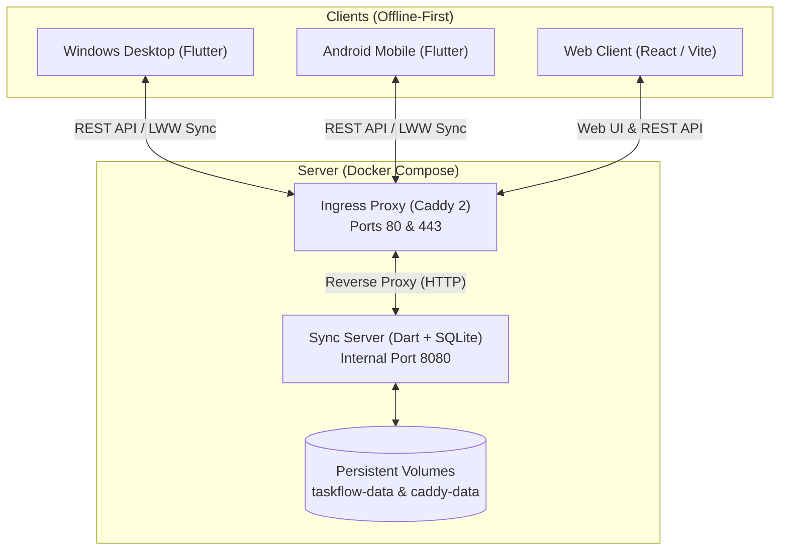

# ToDoz Deployment & Operations Runbook

> **Audience:** Human developers, system administrators, and AI assistants (LLMs).  
> **Security Notice:** This guide is generic, credential-free, and safe for public / open-source repositories. Never commit IP addresses, passwords, API secrets, or private keys to version control.

---

## 1. System Architecture Overview

**ToDoz** is an offline-first task management and synchronization platform comprised of three distinct tiers:



* **Core Package (`packages/taskflow_core`):** Pure Dart domain library with zero Flutter/database imports. Shared by the mobile/desktop app and the sync server.
* **Sync Server (`server/`):** Lightweight Dart service backed by SQLite. Exposes a clean REST API (`/v1/...`), blob storage for attachments/voice notes, signed incoming/outgoing webhooks, and iCal feed subscriptions.
* **Embedded Web Client (`server/web/`):** React + TypeScript web app pre-compiled and embedded directly into the Dart binary (`server/lib/web_assets.dart`), requiring zero Node.js runtime on production.
* **Ingress Reverse Proxy (`caddy:2`):** Automatic SSL provisioning, compression, and Cloudflare-compatible routing.

---

## 2. Server Prerequisites

* **OS:** Any modern Linux distribution (Ubuntu 22.04+, Debian 12+, Rocky/AlmaLinux).
* **Hardware:** Minimal requirements (512MB – 1GB RAM, 1 vCPU, 10GB storage).
* **Software:**
  * Docker Engine (`>= 24.0`)
  * Docker Compose plugin (`>= 2.20`)
  * Git
* **DNS:** A DNS `A` record pointing `<your-subdomain.domain.com>` to the server's public IP.

---

## 3. Fresh Server Deployment Runbook

### Step 1: Clone the Repository to `/opt/todoz`
```bash
sudo mkdir -p /opt/todoz
sudo chown $USER:$USER /opt/todoz
git clone <repository-url> /opt/todoz
cd /opt/todoz/server/deploy
chmod +x deploy.sh
```

### Step 2: Configure Environment Variables
Copy the example environment file:
```bash
cp .env.example .env
```
Populate `.env` with your deployment values:
```bash
TASKFLOW_DOMAIN=todoz.example.com
TASKFLOW_PUBLIC_URL=https://todoz.example.com

# Optional: Google Calendar two-way sync credentials
GOOGLE_CLIENT_ID=
GOOGLE_CLIENT_SECRET=
```

### Step 3: Launch Containers
Run the deployment script in public mode:
```bash
./deploy.sh public todoz.example.com
```

* **What happens automatically:**
  1. Docker builds the Dart sync server via a multi-stage Dockerfile (`server/Dockerfile`).
  2. Sets up isolated named volumes: `deploy_taskflow-data` and `deploy_caddy-data`.
  3. Caddy launches on host ports `80` and `443`, requests an SSL certificate, and routes incoming traffic to `taskflow:8080`.
  4. The script polls the internal health check until the server reports ready.

---

## 4. User Onboarding & Device Pairing

ToDoz does not use passwords or third-party auth providers. Devices authenticate via cryptographically hashed device tokens generated by single-use pairing codes.

### Step 1: Create an Account & Generate an Invite Code
On the server (inside `/opt/todoz/server/deploy`):
```bash
./deploy.sh invite <username>
```
*Output:*
```text
Pairing code for <username>: ABCD-1234
Enter it in the app (Settings, Sync). It works once and expires in 10 minutes.
```

### Step 2: Connect Clients

* **Flutter Native Apps (Windows & Android):**
  1. Open the ToDoz app.
  2. Navigate to **Settings** → **Sync**.
  3. **Server URL:** `https://todoz.example.com`
  4. **Pairing Code:** Enter the 8-character code generated above.
  5. **Device Name:** e.g., `Workstation` or `Pixel`.
  6. Tap **Pair**.

* **Web Browser Client:**
  1. Navigate to `https://todoz.example.com/app`.
  2. Enter the one-time code to authenticate the browser session.

### Step 3 (optional): AI Assistants

**From the web or a phone (Claude, ChatGPT, Gemini):** the server itself is a remote MCP server (Streamable HTTP) at `https://todoz.example.com/mcp`. Caddy passes `/mcp*` to it (the `handle /mcp*` block in `server/deploy/Caddyfile`, so an update that brings a new Caddyfile needs `./deploy.sh update`, which also reloads Caddy). It takes the same personal API tokens as the REST API, either as `Authorization: Bearer tf_...` or inside the address, `https://todoz.example.com/mcp/tf_...`, for connector screens that have no place for a token. The address then holds a secret: the server's log shows it as `/mcp/...`, and Caddy has no access log, but Cloudflare and the assistant's own provider can see it, so give each assistant its own token (a *read only* one if it only needs to look) and revoke it under Settings → Calendar and integrations → API access if it leaks. Wrong guesses at a secret address are limited to 20 a minute per caller address. There is no OAuth sign-in screen. Quick check (should print `401`, and `200` with a valid token):

```bash
curl -s -o /dev/null -w "%{http_code}\n" -X POST https://todoz.example.com/mcp -H "Content-Type: application/json" -d '{"jsonrpc":"2.0","id":1,"method":"ping"}'
```

The setup steps for each assistant are in the help page (`landing/help.html`, the REST API section).

**On your own computer:** Claude (Desktop and Code) and Gemini CLI can add and list tasks through the REST API. The server needs no change: the owner makes an API token in the app under **Settings** → **Calendar and integrations** → **API access** (tick *read only* to let the assistant look but not change anything), and installs the small MCP wrapper from `tool/mcp/` on their own computer:

```bash
claude mcp add todoz --scope user --env TODOZ_URL=https://todoz.example.com --env TODOZ_TOKEN=tf_... -- node /path/to/tool/mcp/server.mjs
```

The wrapper only needs Node.js 20 or newer (no packages), reads `TODOZ_URL` and `TODOZ_TOKEN` from the environment, and never logs the token. `tool/mcp/README.md` has the Claude Desktop and Gemini CLI settings. Calls are rate limited per token like any other REST call; revoke a token in the same Settings page. Assistants that cannot run a local program can call the REST API directly (see the REST API section of the help page).

---

## 5. Operations & Maintenance Reference

All operational tasks are managed via `./deploy.sh` inside `/opt/todoz/server/deploy`:

| Action | Command | Description |
| :--- | :--- | :--- |
| **Check Health** | `./deploy.sh status` | Inspect container status and health. |
| **View Logs** | `./deploy.sh logs` | Stream live server logs. |
| **Create Backup** | `./deploy.sh backup` | Writes a safe, consistent SQLite snapshot into `./backups/`. |
| **Pull & Update** | `./deploy.sh update` | Pulls latest git changes, backs up, rebuilds and restarts the server, and reloads Caddy. |
| **Reload Caddy** | `./deploy.sh reload` | Applies an edited `Caddyfile` without downtime (`update` does this too). |
| **List Users** | `./deploy.sh cli user list` | Displays registered users and storage quotas. |
| **Revoke Device** | `./deploy.sh cli revoke <user> <device_id>` | Signs out a compromised device immediately. |

### Deploying a change (every time you change the code)

**On your computer**

1. If you changed anything under `server/web/` (the web app), rebuild and embed it, because the server image has no Node:
   ```bash
   cd server && python tool/embed_web.py     # builds the page and rewrites lib/web_assets.dart
   ```
   Commit `server/lib/web_assets.dart` too (a test fails when it is out of date).
2. Run the tests you touched (`dart test` in `server/`, `flutter test` for the app), then commit and push:
   ```bash
   git add -A && git commit -m "what changed" && git push
   ```

**On the server**

```bash
cd /opt/todoz/server/deploy
./deploy.sh update        # git pull, backup, rebuild, restart, reload Caddy; ends with "Updated."
./deploy.sh status        # the containers should be "Up"
```

**The todoz.polla.dev server is a git checkout** (since 2026-10-23: `/opt/todoz` tracks `origin/main`, with a *sparse* checkout of only what the server uses: `server`, `packages/taskflow_core`, `landing`, and the README, PHILOSOPHY and DEPLOYMENT files). So `./deploy.sh update` works there. If a future build needs another folder from the repository, add it once with `cd /opt/todoz && git sparse-checkout add /<folder>`. `.env`, `.mode`, the backups and the installers in `landing/downloads/` are not in git and are never touched by an update.

**Turning a plain copy of the folder into a checkout** (what was done; safe on a running server, nothing is moved or restarted):

```bash
cd /opt/todoz && git init -b main
git remote add origin https://github.com/polla-fattah/ToDoz.git
git sparse-checkout set --no-cone /server /packages/taskflow_core /landing /PHILOSOPHY.md /README.md /DEPLOYMENT.md
git fetch origin main && git checkout -f -B main origin/main && git branch --set-upstream-to=origin/main main
cd server/deploy && ./deploy.sh update            # proves the whole route works
```

The installers are not in git (`*.apk`, `*.msi` are ignored), so copy them separately after building: `tool/build_msi.py` writes `landing/downloads/ToDoz-Setup.msi` (it needs `wixl` in WSL), and the release APK is `build/app/outputs/flutter-apk/app-release.apk`. Upload both to `/opt/todoz/landing/downloads/` (as `ToDoz-Setup.msi` and `ToDoz.apk`) and compare `sha256sum` on the server with the local file.

Then reload the page in the browser (Ctrl+F5). The Windows and Android apps are not part of this: they need their own new build (`flutter build windows` / `flutter build apk`) and install.

| What changed | What to do on the server |
| :--- | :--- |
| Server code, the web app, `taskflow_core` | `./deploy.sh update` |
| Only `Caddyfile` or the landing page (`landing/`) | `git pull --ff-only` then `./deploy.sh reload` (or just `./deploy.sh update`) |
| Only `.env` (domain, Google keys) | edit it, then `./deploy.sh update` (it restarts the server with the new values) |
| Something looks wrong afterwards | Read `./deploy.sh logs`. To go back to an older version: `git checkout <older commit>`, then `docker compose --profile public up -d --build` (not `update`, which pulls). Your data is in a Docker volume and stays; `update` made a backup first in `backups/`. |

Quick check that the routes work through Cloudflare and Caddy (should print `401`, not `405` or `200`):

```bash
curl -s -o /dev/null -w "%{http_code}\n" -X POST https://todoz.example.com/api/v1/quick-add/parse -H "Content-Type: application/json" -d "{}"
```

---

## 6. Multi-Tenant Server Guidelines (Co-locating Other Services)

If this server hosts other applications or microservices:

1. **Keep Ports 80 & 443 on Caddy:**
   Do not bind other Docker containers or bare-metal daemons to host ports `80` or `443`.
2. **Routing Additional Domains:**
   To add another domain (e.g., `api.example.com`) to Caddy, append a block to `/opt/todoz/server/deploy/Caddyfile`:
   ```caddy
   http://api.example.com, https://api.example.com {
       encode zstd gzip
       reverse_proxy 127.0.0.1:3000
   }
   ```
   Apply without downtime:
   ```bash
   docker compose exec caddy caddy reload --config /etc/caddy/Caddyfile
   ```
3. **Cloudflare Compatibility:**
   When using Cloudflare proxy (orange cloud), ensure Caddy listens on both `http://` and `https://` schemes (as configured in `Caddyfile`) to prevent 308 redirect loops regardless of Cloudflare's SSL mode (Flexible vs. Full).

---

## 7. Instructions for AI Coding Assistants (LLM Context)

When an AI assistant is asked to update, inspect, or troubleshoot this deployment:

1. **File Locations:**
   * Compose configs: `server/deploy/compose.yaml`
   * Ingress rules: `server/deploy/Caddyfile`
   * Server Dockerfile: `server/Dockerfile`
   * Core logic: `packages/taskflow_core/`
2. **Preserve Compatibility:**
   * Do not alter SQLite schema column types without providing migration paths in `lib/data/database.dart` and `server/lib/db.dart`.
   * Keep `packages/taskflow_core` dependency-free (pure Dart only).
3. **Web Asset Rebuilding:**
   * If modifying files in `server/web/src/`, re-bundle web assets before deployment:
     ```bash
     cd server && python tool/embed_web.py    # builds the page (npm run build in server/web) and embeds it
     ```
   * The embedded assets live in `server/lib/web_assets.dart`.
