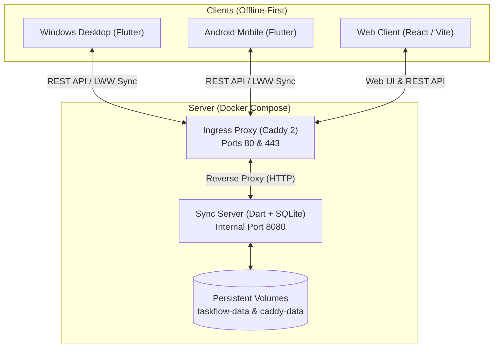

# ToDoz Deployment & Operations Runbook

> **Audience:** Human developers, system administrators, and AI assistants (LLMs).  
> **Security Notice:** This guide is generic, credential-free, and safe for public / open-source repositories. Never commit IP addresses, passwords, API secrets, or private keys to version control.

---

## 1. System Architecture Overview

**ToDoz** is an offline-first task management and synchronization platform comprised of three distinct tiers:



* **Core Package (`packages/taskflow_core`):** Pure Dart domain library with zero Flutter/database imports. Shared by the mobile/desktop app and the sync server.
* **Sync Server (`server/`):** Lightweight Dart service backed by SQLite. Exposes a clean REST API (`/v1/...`), blob storage for attachments/voice notes, signed incoming/outgoing webhooks, and iCal feed subscriptions.
* **Embedded Web Client (`server/web/`):** React + TypeScript web app pre-compiled and embedded directly into the Dart binary (`server/lib/web_assets.dart`), requiring zero Node.js runtime on production.
* **Ingress Reverse Proxy (`caddy:2`):** Automatic SSL provisioning, compression, and Cloudflare-compatible routing.

---

## 2. Server Prerequisites

* **OS:** Any modern Linux distribution (Ubuntu 22.04+, Debian 12+, Rocky/AlmaLinux).
* **Hardware:** Minimal requirements (512MB – 1GB RAM, 1 vCPU, 10GB storage).
* **Software:**
  * Docker Engine (`>= 24.0`)
  * Docker Compose plugin (`>= 2.20`)
  * Git
* **DNS:** A DNS `A` record pointing `<your-subdomain.domain.com>` to the server's public IP.

---

## 3. Fresh Server Deployment Runbook

### Step 1: Clone the Repository to `/opt/todoz`
```bash
sudo mkdir -p /opt/todoz
sudo chown $USER:$USER /opt/todoz
git clone <repository-url> /opt/todoz
cd /opt/todoz/server/deploy
chmod +x deploy.sh
```

### Step 2: Configure Environment Variables
Copy the example environment file:
```bash
cp .env.example .env
```
Populate `.env` with your deployment values:
```bash
TASKFLOW_DOMAIN=todoz.example.com
TASKFLOW_PUBLIC_URL=https://todoz.example.com

# Optional: Google Calendar two-way sync credentials
GOOGLE_CLIENT_ID=
GOOGLE_CLIENT_SECRET=
```

### Step 3: Launch Containers
Run the deployment script in public mode:
```bash
./deploy.sh public todoz.example.com
```

* **What happens automatically:**
  1. Docker builds the Dart sync server via a multi-stage Dockerfile (`server/Dockerfile`).
  2. Sets up isolated named volumes: `deploy_taskflow-data` and `deploy_caddy-data`.
  3. Caddy launches on host ports `80` and `443`, requests an SSL certificate, and routes incoming traffic to `taskflow:8080`.
  4. The script polls the internal health check until the server reports ready.

---

## 4. User Onboarding & Device Pairing

ToDoz does not use passwords or third-party auth providers. Devices authenticate via cryptographically hashed device tokens generated by single-use pairing codes.

### Step 1: Create an Account & Generate an Invite Code
On the server (inside `/opt/todoz/server/deploy`):
```bash
./deploy.sh invite <username>
```
*Output:*
```text
Pairing code for <username>: ABCD-1234
Enter it in the app (Settings, Sync). It works once and expires in 10 minutes.
```

### Step 2: Connect Clients

* **Flutter Native Apps (Windows & Android):**
  1. Open the ToDoz app.
  2. Navigate to **Settings** → **Sync**.
  3. **Server URL:** `https://todoz.example.com`
  4. **Pairing Code:** Enter the 8-character code generated above.
  5. **Device Name:** e.g., `Workstation` or `Pixel`.
  6. Tap **Pair**.

* **Web Browser Client:**
  1. Navigate to `https://todoz.example.com/app`.
  2. Enter the one-time code to authenticate the browser session.

---

## 5. Operations & Maintenance Reference

All operational tasks are managed via `./deploy.sh` inside `/opt/todoz/server/deploy`:

| Action | Command | Description |
| :--- | :--- | :--- |
| **Check Health** | `./deploy.sh status` | Inspect container status and health. |
| **View Logs** | `./deploy.sh logs` | Stream live server logs. |
| **Create Backup** | `./deploy.sh backup` | Writes a safe, consistent SQLite snapshot into `./backups/`. |
| **Pull & Update** | `./deploy.sh update` | Pulls latest git changes and rebuilds containers. |
| **List Users** | `./deploy.sh cli user list` | Displays registered users and storage quotas. |
| **Revoke Device** | `./deploy.sh cli revoke <user> <device_id>` | Signs out a compromised device immediately. |

---

## 6. Multi-Tenant Server Guidelines (Co-locating Other Services)

If this server hosts other applications or microservices:

1. **Keep Ports 80 & 443 on Caddy:**
   Do not bind other Docker containers or bare-metal daemons to host ports `80` or `443`.
2. **Routing Additional Domains:**
   To add another domain (e.g., `api.example.com`) to Caddy, append a block to `/opt/todoz/server/deploy/Caddyfile`:
   ```caddy
   http://api.example.com, https://api.example.com {
       encode zstd gzip
       reverse_proxy 127.0.0.1:3000
   }
   ```
   Apply without downtime:
   ```bash
   docker compose exec caddy caddy reload --config /etc/caddy/Caddyfile
   ```
3. **Cloudflare Compatibility:**
   When using Cloudflare proxy (orange cloud), ensure Caddy listens on both `http://` and `https://` schemes (as configured in `Caddyfile`) to prevent 308 redirect loops regardless of Cloudflare's SSL mode (Flexible vs. Full).

---

## 7. Instructions for AI Coding Assistants (LLM Context)

When an AI assistant is asked to update, inspect, or troubleshoot this deployment:

1. **File Locations:**
   * Compose configs: `server/deploy/compose.yaml`
   * Ingress rules: `server/deploy/Caddyfile`
   * Server Dockerfile: `server/Dockerfile`
   * Core logic: `packages/taskflow_core/`
2. **Preserve Compatibility:**
   * Do not alter SQLite schema column types without providing migration paths in `lib/data/database.dart` and `server/lib/db.dart`.
   * Keep `packages/taskflow_core` dependency-free (pure Dart only).
3. **Web Asset Rebuilding:**
   * If modifying files in `server/web/src/`, re-bundle web assets before deployment:
     ```bash
     cd server/web && npm run build
     python tool/embed_web.py
     ```
   * The embedded assets live in `server/lib/web_assets.dart`.
