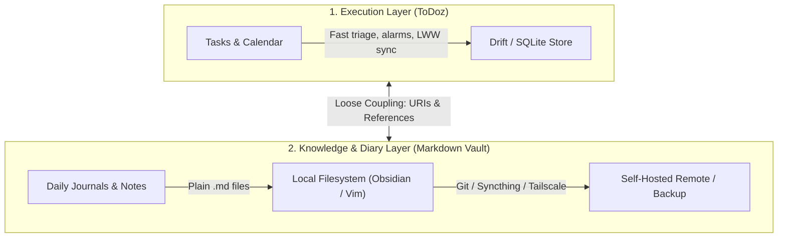

# The ToDoz Philosophy: Principles of Sovereign Productivity

> *"Your data belongs on your devices first. Tools should be fast, deterministic, and respectful of your attention."*

---

## 1. The Core Manifesto

Modern productivity software has lost its way. Mainstream tools (Notion, Todoist, Evernote, ClickUp) have converged into slow, subscription-based, cloud-locked silos burdened with unwanted generative AI summaries, tracking telemetry, and feature bloat.

**ToDoz** was built on a counter-philosophy:
1. **Sovereignty:** You own your data. It resides locally on your hardware.
2. **Speed:** Local interactions must be sub-100ms and operate with zero network dependency.
3. **Determinism:** Core logic (recurring schedules, filters, natural-language quick-add) must be mathematically predictable, not guessed by non-deterministic probabilistic models.
4. **Focus:** A task manager must be an elite execution engine—not an inferior text editor, social network, or bloated project suite.

---

## 2. Foundational Pillars

### Pillar 1: Local-First & Offline Sovereignty
* **The Device is Primary:** Every read, write, query, and state transition occurs against a local data store (e.g., SQLite via Drift). The network is strictly an optional transport layer, never a prerequisite for UI interaction.
* **Resilient to Outages:** Whether on an airplane, in a remote server room, or experiencing a home internet blackout, the application functions identically.
* **Zero UI Latency:** Tapping a checkbox or typing a task should never display a loading spinner.

### Pillar 2: Self-Hosted, Lightweight Synchronization
* **Private Cloud, Not Public Silos:** Synchronization is handled by a single-binary, self-hosted service with minimal operational overhead (e.g., Dart + SQLite, Rust, or Go).
* **Zero Credential Hassle:** Device pairing via short-lived, one-time invitation codes eliminates password management, email verification loops, and third-party auth dependencies.
* **VPN / Zero-Trust Ready:** First-class compatibility with private mesh overlays like **Tailscale** ensures that sync servers never need to expose public open ports to the internet.
* **Pragmatic Merge Strategy:** For personal and small-group operational data, field-level **Last-Write-Wins (LWW)** with change-capture triggers offers 99.9% of the practical utility of complex CRDTs/OT with a fraction of the architectural complexity.

### Pillar 3: Deterministic Parsing Over Probabilistic AI
* **Rule-Based Certainty:** Natural-language inputs (e.g., `Review draft tomorrow at 4pm p1 #research {nov 30}`) are parsed by a deterministic lexer/parser.
* **Explicit Failure Modes:** If an input or recurrence expression (`every 1st wed`) cannot be parsed, the system informs the user why rather than silently guessing incorrectly.
* **Zero Telemetry & Cost:** Deterministic engines run entirely offline with zero battery drain, zero token costs, and zero leakage of personal schedules to external API providers.

### Pillar 4: The Separation of Concerns (Tasks vs. Knowledge)
* **Execution vs. Reflection:**
  * **Tasks are operational, stateful, and ephemeral:** They have checkboxes, due dates, notification alarms, snooze states, and priorities. Once completed, their daily utility diminishes.
  * **Notes and Diaries are archival, relational, and reflective:** They consist of prose, code snippets, retrospective analysis, and cross-linked references. Their value compounds over time.
* **The Anti-Monolith Stance:** Do not build a mediocre text editor inside a task manager, and do not shoehorn a fragile task engine into a markdown note tool. 
* **Loose Coupling:** Connect tools through standard operating-system protocols (URI schemes like `todoz://` and `obsidian://`, terminal CLIs, or calendar `.ics` standards) rather than fusing them into a sluggish monolith.

### Pillar 5: Data Longevity & Plain Text Respect
* **Long-term Survivability:** Any archive that matters for 10 to 50 years (such as daily journals, research thoughts, and project briefs) should exist as **plain Markdown files** stored directly in the local file system.
* **Export Freedom:** Structured task data must always be exportable in open, standard formats (CSV, ICS, JSON) with non-destructive undo and backup safety nets.

---

## 3. Replicating the Philosophy Across Other Ecosystems (e.g., Markdown & Notes)

To build or replicate a complementary system (such as a local-first daily journal or Second Brain) under the exact same philosophy:



### The Blueprint for Markdown-Based Systems:

1. **Local Filesystem as the Single Source of Truth:**
   * Organize documents in standard folders:
     ```text
     SecondBrain/
     ├── Daily/
     │   └── YYYY-MM-DD.md     # Journal, daily log, retrospectives
     ├── Projects/             # Long-term research & business documents
     ├── Literature/           # Reading notes, paper summaries
     └── Attachments/          # Local images, PDFs, media
     ```
2. **Sync Without Vendor Lock-In:**
   * **Option A (Versioned):** Use a private Git repository hosted on a self-hosted server (Gitea/Forgejo) or private repository, synced via automated commit-and-push hooks.
   * **Option B (Real-time P2P):** Use **Syncthing** over local network and Tailscale for seamless, continuous background folder synchronization between PC, server, and phone.
3. **Mobile Read/Write Access:**
   * On mobile, point an offline-first markdown reader/editor (e.g., Obsidian Mobile, Markor, or Logseq) directly to the local synchronized directory.
   * Edits happen locally; sync happens asynchronously in the background.
4. **End-of-Day Synthesis:**
   * Review completed tasks from the execution engine (ToDoz).
   * Write daily reflections, discoveries, and meeting notes in the day's Markdown file (`YYYY-MM-DD.md`).
   * Hyperlink to projects and external assets using standard markdown `[[wiki-links]]` or URI schemes.

---

## 4. The Engineering Evaluation Checklist

Before adding any feature to ToDoz or adopting a new productivity component, evaluate it against these five tests:

1. **The Airplane Test:** Does this feature work seamlessly with no internet connection?
2. **The 100ms Test:** Can this action be executed and visually reflected in the UI in under 100 milliseconds?
3. **The Longevity Test:** If the server or application is discontinued tomorrow, is the user's historical data still completely readable and recoverable?
4. **The Scope Test:** Does this belong to *action/execution* (task), or *reflection/synthesis* (note)? If it is reflection, delegate it to the markdown vault.
5. **The Dependency Test:** Does this introduce an external API dependency or monthly SaaS liability that compromises privacy or system stability? If yes, reject it.
